## Status

Draft → Proposed → Accepted → Deprecated or superseded

## Documents

### Hierarchy

```mermaid
flowchart LR
    PRD["PRD<br/>Product Requirement Document"]
    subgraph parallel["Developed in parallel"]
        SD["System Design"]
        RFC["RFC<br/>Request for comments"]
        SDD["SDD<br/>Security Design Doc"]
        SPK["Spike<br/>output is knowledge,<br/>not production code"]
    end
    FDD["FDD<br/>Feature Design Doc<br/>(immutable)"]
    ADR["ADR<br/>Architecture Decision Record<br/>(immutable)"]
    DL["Decision Log<br/>index of ADRs"]
    PRD --> parallel
    parallel --> FDD
    FDD --> ADR
    ADR -.->|indexed in| DL
    classDef prd fill:#2f5d8a,stroke:#8ec5ff,stroke-width:2px,color:#ffffff
    classDef design fill:#2e7d5b,stroke:#8fe3b8,stroke-width:2px,color:#ffffff
    classDef rfc fill:#8a5a16,stroke:#ffc86b,stroke-width:2px,color:#ffffff
    classDef security fill:#9b2c2c,stroke:#ff9b9b,stroke-width:2px,color:#ffffff
    classDef fdd fill:#5b3f8c,stroke:#c9a8ff,stroke-width:2px,color:#ffffff
    classDef adr fill:#1f6f78,stroke:#7fe0ea,stroke-width:2px,color:#ffffff
    class PRD prd
    class SD design
    class RFC rfc
    class SDD security
    classDef spike fill:#6b2f5e,stroke:#f0a6dd,stroke-width:2px,color:#ffffff
    class SPK spike
    class FDD fdd
    classDef dl fill:#7a6a1f,stroke:#f5e27a,stroke-width:2px,color:#ffffff
    class ADR adr
    class DL dl
    style parallel fill:#1c2b26,stroke:#4fa37a,stroke-width:2px,color:#d8f5e5
```

- The PRD comes first and defines the business problem (the "what" and the "why").
- FDD and ADR are immutable: once written, they are not edited. A change is made by a new document that supersedes the old one.
- System Design, SDD and RFC are developed in parallel, not one after another.

1. [[llm/system design/PRD - Product Requirement Document.md|PRD - Product Requirement Document]]
	- Liga visão de negócio à execução técnica. Define propósito, valor e métricas. É leve, iterativo e coescrito por PMs e tech leads.
	- Detalhes de implementação, como por exemplo o contrato de uma API
2. [[llm/system design/System Design.md|System Design]]
	- Mostra a arquitetura geral, componentes e integrações. Desenvolvido em paralelo com o RFC.
3. [[llm/system design/SDD - Security Design Doc.md|SDD - Security Design Doc]]
	- Threat model, data classification and authentication. Written when the risk is high, for example with sensitive data or external integrations.
4. [[llm/system design/RFC - Request for comments.md|RFC - Request for comments]]
	- Consolida a proposta técnica em cima das decisões; deve haver links apontando para [[llm/system design/ADR - Architecture Decision Record.md|ADR - Architecture Decision Record]]
5. [[llm/system design/FDD - Feature Design Doc.md|FDD - Feature Design Doc]]
	- Como a feature especifica será implementada
	- Define o "como implementar" de uma feature. É o sucessor direto do FRD, mas focado em clareza e execução técnica.
	- Usa linguagem [[software architecture/concepts/Gherkin.md|Gherkin]]
6. [[llm/system design/ADR - Architecture Decision Record.md|ADR - Architecture Decision Record]]
	- Registram decisões arquiteturais ao longo de todo processo
	- Leve e rastreável. Registra decisões arquiteturais ao longo do tempo. É o padrão ouro de governança técnica moderna.

### Investigation

- [[software architecture/concepts/Spike.md|Spike]]
	- Time-boxed investigation that answers open questions before the RFC, FDD or ADR is decided. Its findings support the RFC, and the decisions it settles are recorded as ADRs.

### Tracking

- [[llm/system design/Decision Log.md|Decision Log]]
	- Index of all ADRs, with their status. The ADRs stay immutable; only the status changes.
- [[llm/system design/RAID Register.md|RAID Register]]
	- Single register of risks, assumptions, issues and dependencies. The other documents refer to its IDs.
