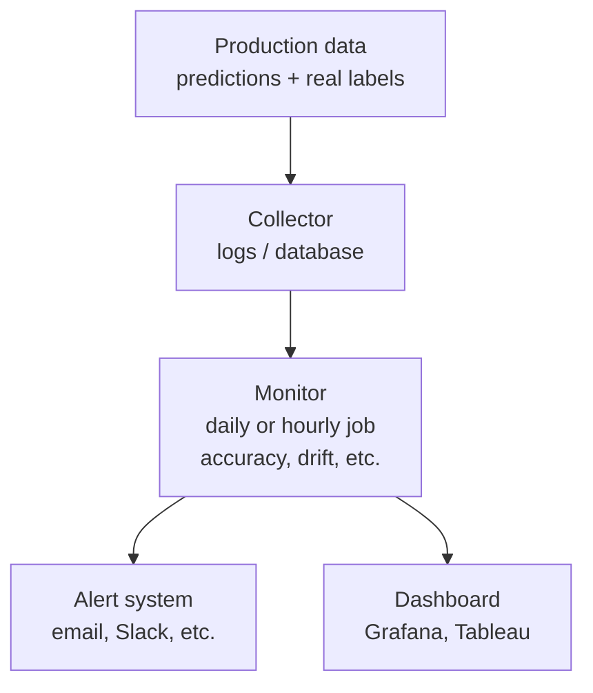

# Monitor Accuracy in Production Continuously

## Why monitor?

In production, the model **is subject to [[Model drift|model drift]]**. [[machine learning/quality/development/Accuracy|Accuracy]] **degrades over time** if it is not monitored and retrained. With imbalanced classes, track [[Precision]], [[Recall]] or [[F1-Score]] instead, since accuracy hides the problem.

Illustrative numbers:

| Month | Without monitoring | With monitoring |
|---|---|---|
| 1 | 85% (deploy) | 85% ✅ |
| 3 | 78% (nobody knows) | 78% ⚠️ alert sent |
| 6 | 65% (found through complaints) | retrained, back to 83% ✅ |
| 12 | 45% (disaster) | 82% ✅ under control |

---

## Monitoring architecture



The collector must **log every prediction with an id and timestamp** (and the model version), so the real label can be joined later.

---

## Monitoring methods

On an endpoint in production you cannot compute accuracy immediately: the real label may take days or weeks to arrive. So there are two families of methods:

- **With ground truth:** the real accuracy, but slow. It is the reference.
- **Without ground truth:** fast proxies that raise an alert. They do not measure accuracy, they only suggest that something changed.

### 1. **[[machine learning/concepts/Ground Truth|Ground Truth]]** (ideal but expensive)

Collect the **real labels** and compare them with the predictions.

```python
from sklearn.metrics import accuracy_score

# At prediction time
prediction = model.predict(new_customer)
save_prediction(customer_id, prediction, timestamp, model_version)

# Later, when the real label becomes available (days/weeks later)
real_label = get_real_label(customer_id)
save_real_label(customer_id, real_label)

# Compute accuracy on a recent window, only for rows that already have a label
y_true, y_pred = load_labeled_predictions(last_days=7)
accuracy = accuracy_score(y_true, y_pred)
```

**Problems:**
- Real labels take time to appear (days/weeks)
- Expensive (human feedback is needed in some cases)
- Not always available
- Recent windows contain only the early-labeled rows, which may be a biased subset

**Typical latency:**
```
day 0:   model predicts "Approve credit"
day 30:  ground truth appears (customer paid / did not pay)
day 30:  accuracy is computed, drift is discovered
```

---

### 2. **Confidence / probability scores** (⚡ seconds)

Use the **confidence the model has** in its own prediction.

```python
# Model returns probabilities, shape (n_samples, n_classes)
proba = model.predict_proba(X_new)

# [0.2, 0.8] = 80% confidence in class 1
confidence = proba.max(axis=1)

# For a binary model the max probability is always >= 0.5,
# so choose a threshold above that (e.g. 0.6)
uncertain = confidence < 0.6
if uncertain.mean() > 0.2:
    print("⚠️ Many uncertain predictions")
    # Options: send to human review, use a fallback model

# Monitor the mean confidence over time, against the baseline at deploy
if confidence.mean() < 0.65:
    print("⚠️ Mean confidence dropped!")
```

**Pros:** instant, simple
**Cons:** not real accuracy, it is a proxy. Poorly calibrated models can be confidently wrong, and a model can stay confident under concept drift.

---

### 3. **Proxy metrics: score distribution** (⚡ minutes/hours)

Use **proxy** metrics that correlate with accuracy, such as the distribution of the model's scores.

```python
# Example: fraud detection
fraud_scores_prod = load_scores_last_day()
fraud_scores_ref = load_reference_scores()  # scores on a held-out set at deploy time

# Compare the distributions
from scipy.stats import ks_2samp
stat, pvalue = ks_2samp(fraud_scores_ref, fraud_scores_prod)

if pvalue < 0.05:
    print("⚠️ Distribution changed! (possible drift)")
```

Use scores from **held-out data** as the reference: scores on the training data are overfit and look different from production even without drift. With large samples, also look at the KS statistic, not only the p-value, or use [[Population Stability Index (PSI)]].

**Pros:** fast detection (minutes/hours)
**Cons:** not real accuracy, it is an approximation

---

### 4. **Prediction distribution monitoring** (⚡ minutes)

Monitor the **distribution of the model's predictions**.

```python
# Today's predictions
y_pred_today = model.predict(X_prod_today)
positive_rate_today = (y_pred_today == 1).mean()  # share of class 1

# Reference: the same model's predictions on held-out data at deploy time
positive_rate_ref = (model.predict(X_validation) == 1).mean()

# Compare as a relative change, so it also works for rare classes
relative_change = abs(positive_rate_today - positive_rate_ref) / positive_rate_ref
if relative_change > 0.25:
    print("⚠️ Prediction distribution changed!")
    print("   → Possible drift or different data")
```

Do not compare against the positive rate of the *training labels*: the model's predicted rate and the label rate are different quantities. And a fixed absolute threshold (e.g. 15 points) is useless for rare classes such as fraud at 2%.

**Pros:** fast, no ground truth needed
**Cons:** does not measure accuracy, it detects anomalies. The positive rate can also change legitimately (seasonality).

---

### 5. **Disagreement with a baseline model** (⚡ seconds)

Use a **second, simpler model** as a cross-check of the main model.

This is **not** the [[champion and challenger]] strategy. The baseline model is a permanent monitoring probe: it receives the **same production inputs** as the main model, but its predictions are **never delivered** to users or used in decisions, and it is never meant to replace the main model. A challenger, in contrast, is a candidate to be promoted, judged on labeled data.

```python
# Main model: complex XGBoost
y_pred_main = xgboost_model.predict(X_prod)

# Baseline model: simple decision tree (fast), same inputs, output not delivered
y_pred_baseline = decision_tree.predict(X_prod)

# Track the disagreement rate over time
disagreement_rate = (y_pred_main != y_pred_baseline).mean()

if disagreement_rate > baseline_disagreement + 0.05:
    print("⚠️ The models disagree more than usual!")
    send_alert()
```

A disagreement is **not proof of an error**: the complex model is expected to differ from the simple one. What is informative is a **change** relative to the disagreement measured at deploy time (e.g. 8% at deploy, 20% now), not a fixed absolute threshold. The signal means "investigate" (input drift, score distributions, ground truth when it arrives), not "retrain" by itself.

**Pros:** detects changes without ground truth
**Cons:** depends on a well-trained simple model; indirect signal; blind to changes that fool both models in the same way (e.g. some [[concept drift]])

---

### 6. **User feedback loop** (📊 days)

Collect feedback from users about the predictions.

```python
# After making a prediction
prediction_id = "pred_12345"
prediction = model.predict(X)  # predicts "not fraud" (0)

# User clicks "Is this right?" → "correct" or "incorrect"
feedback = get_user_feedback(prediction_id)

if feedback is not None:
    # Binary case: "incorrect" means the real label is the other class.
    # For multi-class, ask the user for the correct label instead.
    y_real = prediction if feedback == "correct" else 1 - prediction
    y_pred_feedback.append(prediction)
    y_true_feedback.append(y_real)

# Compute accuracy on the collected feedback
if len(y_true_feedback) > 50:
    accuracy_feedback = accuracy_score(y_true_feedback, y_pred_feedback)
    print(f"Accuracy (with feedback): {accuracy_feedback:.2%}")
```

**Pros:** real ground truth
**Cons:** slow (days/weeks), and not everyone answers. Responses are usually **biased**: users tend to report mistakes more than confirmations, so the accuracy from feedback alone can be pessimistic.

---

### 7. **Input drift** (⚡ minutes)

Monitor the **input features**, not only the outputs. Compare each important feature against the training distribution with the KS-test, chi-square or [[Population Stability Index (PSI)]].

**Pros:** fast, cheap, points at which feature changed
**Cons:** blind to [[concept drift]], where the inputs look the same but the relationship with the target changed

---

### 8. **[[champion and challenger]]: weekly automatic retraining** (📅 week)

In addition to continuous monitoring, **train a new model periodically** and compare it with the champion. It does not replace monitoring: it is the action you take when monitoring says the model got stale.

```python
MARGIN = 0.01  # minimum gain required to promote

def weekly_training(X_recent, y_recent, X_test_recent, y_test_recent):
    """Run once a week. The test set must be recent and labeled."""

    # 1. Train the CHALLENGER on new data
    challenger = RandomForestClassifier()
    challenger.fit(X_recent, y_recent)
    challenger_accuracy = challenger.score(X_test_recent, y_test_recent)

    # 2. Load the CHAMPION (model in production)
    champion = load_champion()
    champion_accuracy = champion.score(X_test_recent, y_test_recent)

    # 3. Compare: who wins?
    if challenger_accuracy > champion_accuracy + MARGIN:
        print(f"🎉 CHALLENGER WON! (+{challenger_accuracy - champion_accuracy:.1%})")
        deploy_challenger(challenger)  # keep the old champion for rollback
    else:
        print("❌ Challenger lost")  # keep the current model
```

**Pros:** automatic, adapts to fast drift
**Cons:** expensive (weekly retraining), needs a reliable recent test set, and can make things worse if the test set is not representative

---

## Method comparison

| Method | Delay | Reflects real accuracy? | Cost | Role |
|---|---|---|---|---|
| **[[machine learning/concepts/Ground Truth\|Ground Truth]]** | ⏳ Weeks | ✅ Yes (reference) | $$$ | Reference |
| **Confidence scores** | ⚡ Seconds | Indirect | $ | Early alert |
| **Score distribution (proxy)** | ⚡ Minutes | Indirect | $ | Early alert |
| **Prediction distribution** | ⚡ Minutes | Indirect | $ | Early alert |
| **Disagreement with a baseline model** | ⚡ Seconds | Indirect | $$ | Early alert |
| **User feedback loop** | 📊 Days | Partial (biased) | $$ | Medium-term check |
| **Input drift** | ⚡ Minutes | No (only detects change) | $ | Early alert |
| **[[champion and challenger]]** | 📅 Week | ✅ Yes, on a recent test set | $$$ | Action |

---

## Summary

| Aspect | Description |
|---|---|
| **Why** | Detect [[Model drift]] early |
| **What** | Accuracy (real), confidence, distributions (proxy) |
| **When** | Daily (monitoring) + weekly (retraining) |
| **How** | **Fast:** confidence → proxy → distributions → input drift |
| | **Real:** ground truth → accuracy → alert |
| | **Action:** weekly champion-challenger |
| **Response** | Alert → investigation → retrain → deploy |

Use fast signals as an **alert** and ground truth as the **confirmation**.
