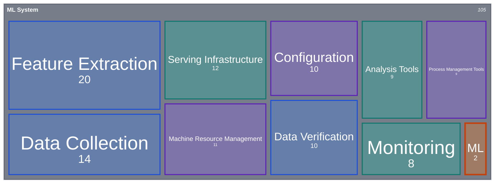

#machinelearning #mlops #architecture

The **core components** of a production ML system. The model code (ML) is only a small part of it: most of the system is the surrounding infrastructure for data, configuration, resources, serving and monitoring.

**Color legend:** 🔵 data (collection, features, verification) · 🟣 infrastructure (configuration, resources, process management) · 🟠 model (ML) · 🟢 operations (analysis, serving, monitoring).

> The values are illustrative, only to show that the ML code is a small block compared to the rest of the system. They are not measurements.

## Components

| Component                       | Role                                                                                     |
| ------------------------------- | ---------------------------------------------------------------------------------------- |
| **Configuration**               | Parameters, hyperparameters and environment settings, versioned and reproducible         |
| **Data Collection**             | Ingestion of raw data from sources such as databases, logs, APIs and streams             |
| **Feature Extraction**          | Transforms raw data into features for training and inference                             |
| **Data Verification**           | Validates schema, distribution and quality before the data is used                       |
| **ML**                          | The model code: training, evaluation and the algorithm itself                            |
| **Machine Resource Management** | Allocation of CPU, GPU, memory and storage for training and serving                      |
| **Analysis Tools**              | Inspection of data and model results, such as metrics, explainability and error analysis |
| **Process Management Tools**    | Orchestration of pipelines, scheduling, experiment tracking and versioning               |
| **Serving Infrastructure**      | Delivers predictions in batch or online through APIs                                     |
| **Monitoring**                  | Tracks system health, data drift, model performance and alerts                           |
