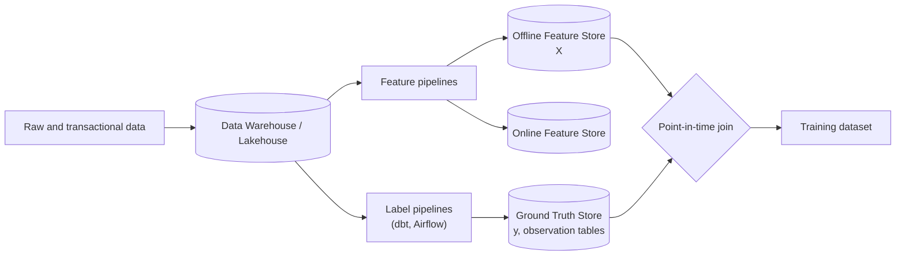

# Ground Truth Store

The **Ground Truth Store** (also called **Label Store**) manages the **real-world truth** of a model, the target **y**. The [[Offline Feature Store]] manages **X**, the independent variables. The Ground Truth Store manages what actually happened later: a confirmed fraud, a payment that defaulted, a click or a purchase.

The concept of the label itself is in [[Ground Truth]]. This note is about the **system** that stores and versions it.

## Observation tables

In mature data architectures, labels are stored as **observation tables**. Each row is one observation, the pair (entity, moment of decision) with the outcome observed later.

| Column | Example | Role |
|---|---|---|
| Entity key | `user_id`, `transaction_id` | Identifies what was predicted |
| `event_timestamp` | `2026-03-10 14:02` | When the decision was made or the event happened. Used for the [[point-in-time]] join |
| `label` | `1` (fraud confirmed within 30 days), `0` otherwise | The real outcome, the target y |

Recommended extra columns, for delayed feedback and audit:

| Column | Why |
|---|---|
| `label_observed_at` | When the label became known. It tells you whether the label is mature enough to use |
| `label_updated_at` | When the label was last changed. Labels can be corrected (see mutability below) |

## Why a Lakehouse or Data Warehouse

**Delayed feedback.** Labels rarely exist in real time. To predict credit default within 90 days, the label only exists three months after the decision. A warehouse or lakehouse supports batch reprocessing, partitioning by date and retroactive updates, efficiently. Table formats with ACID support (Delta Lake, [[Apache Iceberg]]) make these updates safe.

**Mutability and audit.** Labels change over time. A transaction marked as legitimate today can be classified as fraud 60 days later, after a chargeback. Analytical storage on the cloud handles this history well, much better than an online store or a transactional database.

**Scale and lineage.** Labels come from business rules applied to large volumes: joins between payment tables, access logs and external systems. ELT and orchestration tools that run on the lakehouse, such as [[dbt]] and [[Apache Airflow]], are the natural way to compute and audit these rules. See [[Data Lineage]].

## How it fits the architecture

1. **Raw data** arrives and feeds the warehouse or lakehouse.
2. **Feature engineering** computes the features and publishes them to the [[Offline Feature Store]] and the [[Online Feature Store]].
3. **Label pipelines** compute the outcomes and store them in the Ground Truth Store.
4. **Training:** the ML framework reads the Ground Truth Store as the main table, then joins the features to it **point-in-time**. The result is a training dataset without leakage. See [[point-in-time]] and [[Data Leakage]].

The label table is the spine of the training set. Features are attached to it, not the other way around.

## Label maturity

A label is only useful when its window has closed. A 30-day fraud label computed on day 10 is incomplete: some frauds have not been reported yet, so the negatives are wrong.

- Use only labels whose window has closed, or use `label_observed_at` to filter them.
- For evaluation, compare the model on mature labels only.
- Monitor the share of labels that are still pending (see [[Open loop monitoring]]).

## Label history

Labels change, so the store must keep the history:

- **Append, do not overwrite.** Keep each version with `label_updated_at`, the same rule as the [[Offline Feature Store]].
- **Snapshot the labels used for training,** and save the snapshot ID with the model, so the dataset can be rebuilt. See [[model registry]].
- **Separate the two timelines:** the moment of the decision (`event_timestamp`) and the moment the outcome became known (`label_observed_at`).

## Examples

- **Fraud:** `label = 1` if the transaction was confirmed as fraud within 30 days, including chargebacks that arrive late.
- **Credit default:** `label = 1` if the customer defaulted within 90 days of the credit decision. The label exists only after 90 days.
- **Conversion:** `label = 1` if the user bought within 7 days of seeing the offer.

## Common pitfalls

- Training on immature labels, which makes the negatives look like negatives when they are only pending
- Overwriting labels in place, which removes the history needed for audit and reproducible training
- Using the label-computation date instead of `event_timestamp` in the point-in-time join
- Computing labels with logic that differs between the training pipeline and the reporting pipeline
- Having no snapshot ID, so a model cannot be traced to its training data

## Related

- [[Ground Truth]]
- [[Offline Feature Store]]
- [[Online Feature Store]]
- [[point-in-time]]
- [[Data Leakage]]
- [[Open loop monitoring]]
- [[Data Lineage]]
