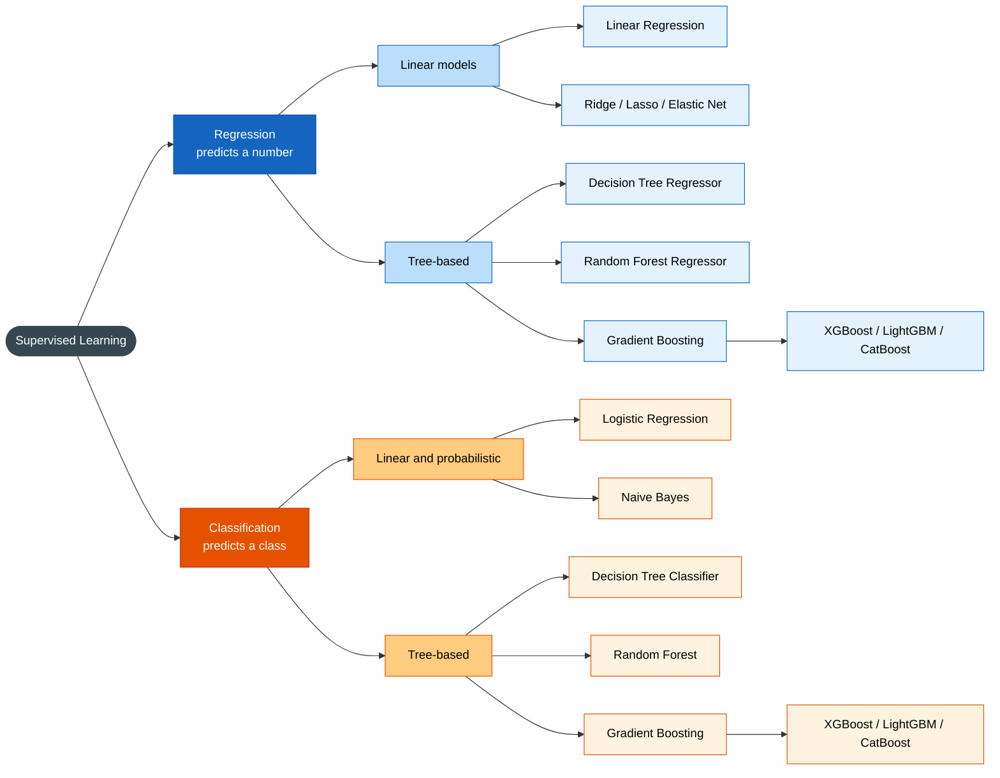

#supervised-learning #predictive 

Labeled, so there is a target to predict.

| Task                                    | Predicts                       | Example                                                 | Frameworks             |
| --------------------------------------- | ------------------------------ | ------------------------------------------------------- | ---------------------- |
| **Ranking / learning to rank**          | An ordering of items           | Search results, recommendations                         |                        |
| **[[Time series forecasting]]**         | Future values of a sequence    | Sales next month (see [ARIMA](app://obsidian.md/ARIMA)) | [[Google TimesFM 3.0]] |
| **Structured prediction**               | Sequences or structures        | Translation, named entity recognition                   |                        |
| **Object detection / segmentation**     | Boxes or pixel masks in images | Self-driving, medical imaging                           |                        |
| **Multi-label classification**          | Several labels at once         | Tags on an article                                      |                        |
| **Survival analysis**                   | Time until an event            | Time until churn or failure                             |                        |
| **Probabilistic / quantile regression** | A distribution or interval     | Forecast range                                          |                        |

## Most used algorithms

Regression predicts a number, classification predicts a class. Tree-based algorithms cover both tasks.

How to read it:

- **Blue**: regression branch (predicts a number).
- **Orange**: classification branch (predicts a class).
- Darker shade = task, medium = algorithm family, lighter = algorithm.
- Tree-based: Random Forest reduces variance (bagging); Gradient Boosting and XGBoost reduce bias (boosting) and are usually the best on tabular data.
- Levels: paradigm → task → algorithm family → algorithm. Algorithms that serve both tasks (trees, boosting) appear under each task, using the regressor or classifier variant.
- Logistic regression is, despite its name, a classifier: a linear model passed through a sigmoid.

Details per algorithm in [[Machine Learning Algorithms|Machine Learning Algorithms]].

## References

[[Evaluation classification model metrics]]
