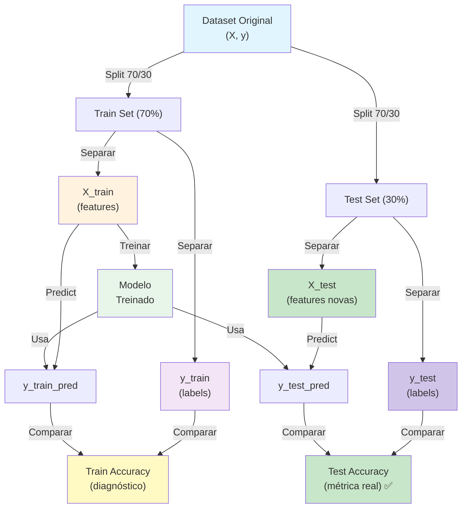

[[model training]]|[[Model drift]]

**Accuracy** é a **porcentagem de previsões corretas** que o modelo faz. Existem dois tipos críticos:

- **Train Accuracy** = Avaliado em dados de **treino** (para diagnóstico)
- **Test Accuracy** = Avaliado em dados **novos/nunca vistos** (métrica real)
- **Production Accuracy** = Requer [[machine learning/concepts/Ground Truth|Ground Truth]] que pode levar dias ou meses para chegar

---

## Fórmula

```
Accuracy = (Previsões Corretas) / (Total de Previsões)

Exemplo Train:
- 7.000 amostras de treino
- 5.950 previsões corretas
- Train Accuracy = 5.950 / 7.000 = 85%

Exemplo Test:
- 3.000 amostras de teste
- 2.550 previsões corretas
- Test Accuracy = 2.550 / 3.000 = 85%
```

---

## Fluxo Completo: Dataset → Train & Test Accuracy



---

## Train Accuracy vs Test Accuracy

### Propósito

| Métrica | Dados | Propósito | Uso |
|---------|-------|----------|-----|
| **Train Accuracy** | Mesmos dados do treino | Diagnóstico (detectar problemas) | Apenas análise interna |
| **Test Accuracy** | Dados **nunca vistos** | Avaliação real (sucesso final) | **SEMPRE reporte isso** ✅ |

---

## 3 Cenários Críticos

### ✅ Cenário 1: Modelo Aprende Bem
```
Train Accuracy: 85%
Test Accuracy:  82%
Diferença: 3% (pequena) ✅

Diagnóstico: Modelo generalizou bem!
→ Confia neste modelo para produção
```

### ❌ Cenário 2: [[Overfitting]] (Decorou o Treino)
```
Train Accuracy: 95%
Test Accuracy:  60%
Diferença: 35% (enorme) ❌

Diagnóstico: Modelo decorou treino, não aprendeu de verdade
→ NÃO confie neste modelo para produção
```

### ❌ Cenário 3: [[Underfitting]] (Modelo Fraco)
```
Train Accuracy: 65%
Test Accuracy:  63%
Diferença: 2% (pequena, mas ambos baixos) ❌

Diagnóstico: Modelo não aprendeu bem
→ Precisa de mais dados, features ou complexidade
```

---

## Interpretação por Faixa

### Train Accuracy (Diagnóstico)

| Valor | Significado |
|-------|------------|
| **> 95%** | Muito alta (⚠️ cuidado com overfitting) |
| **80-95%** | Boa (modelo aprendeu bem) |
| **60-80%** | Aceitável (depende do problema) |
| **< 60%** | Baixa (modelo não aprendeu) |

### Test Accuracy (Métrica Real)

| Valor | Significado |
|-------|------------|
| **> 95%** | Excelente (problema fácil ou separação perfeita) |
| **80-95%** | Muito bom (modelo generalizou bem) ✅ |
| **60-80%** | Aceitável (depende do problema) |
| **< 60%** | Baixa (modelo precisa melhorar) |

---

## Código em Python

### Calcular Train Accuracy

```python
from sklearn.metrics import accuracy_score

# Após treinar o modelo
y_train_pred = modelo.predict(X_train)
train_accuracy = accuracy_score(y_train, y_train_pred)

print(f"Train Accuracy: {train_accuracy:.2%}")
# Output: Train Accuracy: 85.00%
```

### Calcular Test Accuracy

```python
from sklearn.metrics import accuracy_score

# Após treinar o modelo
y_test_pred = modelo.predict(X_test)
test_accuracy = accuracy_score(y_test, y_test_pred)

print(f"Test Accuracy: {test_accuracy:.2%}")
# Output: Test Accuracy: 85.00%
```

### Comparar Ambas (Diagnóstico)

```python
print(f"Train Accuracy: {train_accuracy:.2%}")
print(f"Test Accuracy:  {test_accuracy:.2%}")
print(f"Diferença: {abs(train_accuracy - test_accuracy):.2%}")

# Diagnóstico
if abs(train_accuracy - test_accuracy) > 0.15:  # Diferença > 15%
    print("⚠️ Possível OVERFITTING!")
elif train_accuracy < 0.6 and test_accuracy < 0.6:
    print("❌ Modelo FRACO (underfitting)")
else:
    print("✅ Modelo generalizou bem!")
```

---

## Analogia: Exame na Escola

| Conceito | Analogia |
|----------|----------|
| **Train Dataset** | Exercícios que o professor passa |
| **Test Dataset** | Prova final do exame |
| **Train Accuracy** | % que você acertou nos exercícios em casa |
| **Test Accuracy** | % que você acertou na prova (o que conta!) |

**O que importa?** A nota da **prova (Test Accuracy)**, não dos exercícios! 🎓

---

## ⚠️ Regra de Ouro

```
✅ SEMPRE compare Train vs Test para diagnóstico
   → Detecta overfitting, underfitting, problemas

✅ SEMPRE reporte Test Accuracy como resultado final
   → É a única métrica que importa para decisões

❌ NUNCA confie só em Train Accuracy
   → Pode ser enganosa (modelo pode ter decorado)

❌ NUNCA reporte Train como desempenho final
   → Não reflete desempenho real em dados novos
```

---

## Resumo Executivo

| Aspecto | Train | Test |
|--------|-------|------|
| Dados | Mesmo do treino | **Nunca vistos** |
| Confiabilidade | Pode enganar | Reflete realidade |
| Uso | Diagnóstico | **Decisão** ✅ |
| Reporte | Não | **Sempre** ✅ |
| Regra | Train ≥ Test sempre | Sempre > 70% |

[[ML metrics]]
