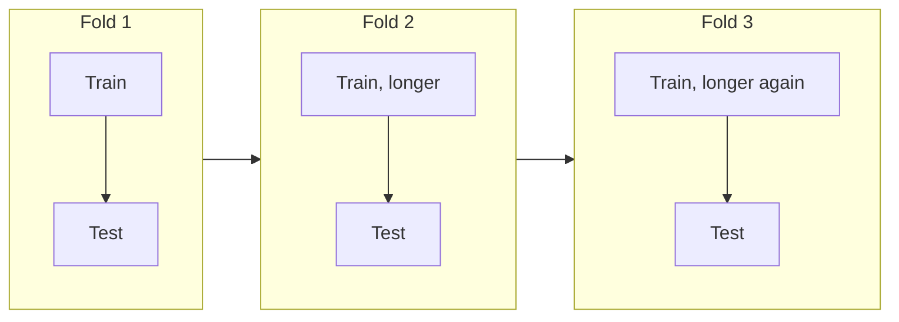

---
aliases:
  - Backtesting
  - Walk-forward validation
  - Rolling-origin evaluation
  - Time series cross-validation
---
#evaluation #time-series #model-selection #validation

# Backtest

A **backtest** evaluates a model (or a strategy) by **replaying the past**: at each past date, it uses only the data that was available then, makes a prediction, and compares it with what really happened afterward. It answers "How would this model have performed if I had used it back then?"

It is the right way to validate any model whose data has a **time order**: forecasting, demand and sales, [[Churn]], [[Credit approval]], prices and trading. The key rule is that **the training data always comes before the test data**.

>[!tip] A backtest is cross-validation that respects the arrow of time: train on the past, test on the future, then move forward and repeat.

- It needs a [[Offline Feature Store]] with [[point-in-time]] feature
- If just join the input with precalculated responses, it is just a analytical query, not a backtest
- To consider a backtest, a model should run and the results must be compared with labels, stored on [[Data Lakehouse|Data Lakehouse]]

For the general idea of splitting data see [[train dataset and test dataset]] and [[K-Fold Cross-Validation]]. This note covers what changes when time matters. See also [[Time series forecasting]].

## Why random cross-validation is not enough

Random [[K-Fold Cross-Validation]] shuffles the rows, so the model trains on **later** rows to predict **earlier** ones. With time-ordered data this causes **temporal leakage** (see [[Data Leakage]]):

- Neighboring days or customers are very similar, and a random split puts them in both train and test.
- Lag features, rolling averages and trends carry information across the split.
- The data changes over time (trend, seasonality, new regimes), so the future does not look like a random sample of the past. See [[Model drift]].

The score from a random split is therefore **optimistic**. A backtest gives a more realistic estimate, and it also shows **how the performance changes over time**, which one number cannot.

## How a backtest works

1. Choose a **forecast origin** (a cut-off date).
2. Train the model using only the data **before** the origin.
3. Predict the **test window** after the origin (the forecast horizon).
4. Score the predictions against the real values.
5. **Move the origin forward** and repeat. Average the scores, and look at each one.

### Window schemes

| Scheme | Training data | Use when |
|---|---|---|
| **Single holdout** | One cut: train before, test after | A quick check, or the final test on the newest data |
| **Expanding window** | Grows with every fold: all data up to the origin | Old data is still relevant, and data is scarce |
| **Rolling (sliding) window** | A fixed length that moves with the origin | The process changes over time, and old data hurts |
| **Walk-forward** | Expanding or rolling, with a **refit at every step** (or every N steps) | You want to simulate how the model will really be retrained in production |

Related options:

- **Gap (embargo):** leave a gap between train and test, so that features built from a window (for example the last 30 days) cannot overlap with the test period. Use it when the label or a feature looks ahead in time, for example when the churn label covers the next 90 days.
- **Horizon:** the test window must match how the model will be used (the next day, the next week, 90 days). A model can be good at one step ahead and poor at 30 steps ahead.
- **Refit frequency:** in production the model is retrained on a schedule. The backtest should retrain on the same schedule.



## Example (synthetic data)

An illustration with a generated daily series, **not real data**: 3 years of data plus 90 more days kept as the "future". The series has a trend, weekly and yearly seasonality, autocorrelated noise and a **level shift** near the end. The features are lags (1, 7 and 14 days), a rolling 7-day mean, day of week, yearly seasonality terms and a trend index. The model is `HistGradientBoostingRegressor`, and the metric is the MAE.

```python
import numpy as np
from sklearn.ensemble import HistGradientBoostingRegressor
from sklearn.model_selection import KFold, TimeSeriesSplit
from sklearn.metrics import mean_absolute_error

# X, y: features and target ordered by date. X_hist, y_hist exclude the final 90 days.
def make_model():
    return HistGradientBoostingRegressor(random_state=0)

# Random K-Fold: shuffles time, so it is optimistic
random_scores = []
for train, test in KFold(5, shuffle=True, random_state=0).split(X_hist):
    model = make_model().fit(X_hist.iloc[train], y_hist.iloc[train])
    random_scores.append(mean_absolute_error(y_hist.iloc[test], model.predict(X_hist.iloc[test])))

# Backtest: expanding window, 5 folds of 60 days. Use gap=... to add an embargo
backtest_scores = []
for train, test in TimeSeriesSplit(n_splits=5, test_size=60).split(X_hist):
    model = make_model().fit(X_hist.iloc[train], y_hist.iloc[train])   # refit on the past only
    backtest_scores.append(mean_absolute_error(y_hist.iloc[test], model.predict(X_hist.iloc[test])))

# Final check on the newest data: train on all the history, test on the last 90 days
model = make_model().fit(X_hist, y_hist)
future_mae = mean_absolute_error(y_future, model.predict(X_future))
```

| Evaluation | MAE |
|---|---|
| Random 5-fold cross-validation | 10.64 |
| Backtest, expanding window (mean of 5 folds) | 11.96 |
| **Real future (last 90 days)** | **16.08** |

Backtest, fold by fold (each test window is 60 days):

| Fold | Train rows | Test rows | MAE | MAPE |
|---|---|---|---|---|
| 1 | 0 to 780 | 781 to 840 | 11.28 | 3.58% |
| 2 | 0 to 840 | 841 to 900 | 11.69 | 3.70% |
| 3 | 0 to 900 | 901 to 960 | 13.53 | 4.31% |
| 4 | 0 to 960 | 961 to 1020 | 9.92 | 3.32% |
| 5 | 0 to 1020 | 1021 to 1080 | 13.37 | 4.11% |

What the results show:

- **The estimates get more honest as the evaluation gets closer to production:** random cross-validation (10.64) is the most optimistic, the backtest (11.96) is more realistic, and the real future (16.08) is the worst, because it includes the level shift that the model had not seen.
- **Fold by fold, the error is not stable** (from 9.92 to 13.53). The average hides this. A backtest tells you how much the performance varies, and when it gets worse.
- **Compare against baselines on the same folds.** The mean backtest MAE was 21.16 for "same as yesterday", 14.22 for "same as last week" (seasonal naive), 11.29 for a Ridge regression, and 11.96 for gradient boosting. Here the **simple linear model beat gradient boosting**, because the series has a trend that trees cannot extrapolate. See [[baseline]].
- **A leaky feature hides in a backtest too.** Adding a feature built with a **centered** rolling mean (it uses the days after the prediction) improved the backtest MAE from 11.96 to 9.87. The split was correct, but the feature used the future, so the score is fake. A backtest only helps if the **features** are also built point-in-time.
- **An expanding window beat a rolling 365-day window here** (11.96 versus 13.49), because the data is scarce and the patterns are stable. With a changing process, the opposite can happen.

The differences between the methods are modest on this single synthetic series. Do not read the exact numbers as general facts. The pattern (random below backtest below real future) is the point.

## What to report

- The **mean and the spread** of the metric across folds, not only the mean. See [[MAE - Mean Absolute Error]], [[MAPE - Mean Absolute Percentage Error]] and [[Evaluating regression model metrics]].
- The score **per fold or per period**, to see if the model degrades over time.
- The score **per segment** (product, region, customer type) and by **forecast horizon**.
- The **baseline** score on the same folds, and the improvement over it.
- The **business metric** (revenue, cost, profit), not only the statistical one.

## Backtesting a strategy (finance, pricing, campaigns)

When the model drives decisions (trading, pricing, a retention campaign), the backtest simulates the **decisions and their results**, not only the predictions. More things can go wrong:

| Bias | What goes wrong |
|---|---|
| **Look-ahead bias** | Using information that was not available at the decision time. For example, restated figures, or data corrected later. See [[point-in-time]] |
| **Survivorship bias** | Using only the companies, customers or products that still exist today, and ignoring the ones that disappeared |
| **Overfitting the backtest** | Trying many variants on the same history until one looks great. It is a result of selection, not skill. Keep a final, untouched test period. See [[Overfitting]] |
| **Ignoring costs** | Fees, slippage, delays, offer costs and capacity limits. A strategy can look profitable only because costs are ignored |
| **Unrealistic execution** | Assuming that decisions were taken at a price or time that could not have been reached |
| **Regime change** | The past period was unusual (a boom, a crisis) and does not represent the future |

## Backtest data must be point-in-time

The training set and the features at each origin must be what was **known at that date**: the feature values as they were, the labels as they were known (labels can arrive late, see [[Ground Truth]]), and no later corrections. Rebuilding the data with today's values leaks the future. A [[Offline Feature Store]] keeps the feature history and builds each training set with a point-in-time join. See [[point-in-time]].

## Backtest versus monitoring

| | Backtest | Monitoring |
|---|---|---|
| When | Before deployment (and when a model is changed) | After deployment, continuously |
| Data | Historical, replayed | Live |
| Question | Would this have worked in the past? | Is it working now? See [[Model drift]] and [[Steps to model monitoring]] |

A backtest can also compare a new model against the current one on the same history before replacing it. See [[champion and challenger]].

## Common pitfalls

- Using random K-Fold or `train_test_split` with shuffling on time-ordered data
- Leakage through the features: centered or future rolling windows, target-derived features, values corrected later
- No gap when the label or the features look ahead, so train and test overlap in time
- Preprocessing (scaling, imputation, encoding) fitted on all the data instead of inside each training fold. Use a `Pipeline`
- Reporting only the average, and missing a period where the model failed
- No baseline on the same folds
- Tuning on the backtest again and again, then reporting the same backtest as the final result. Keep a last untouched period
- Too few folds or too short test windows, which gives noisy estimates
- A backtest that retrains with a different schedule than production
- Ignoring costs, delays and capacity limits when backtesting a strategy
- Assuming that the past regime continues

## Related

- [[K-Fold Cross-Validation]]
- [[train dataset and test dataset]]
- [[Model Evaluation]]
- [[Data Leakage]]
- [[point-in-time]]
- [[Offline Feature Store]]
- [[Time series forecasting]]
- [[ARIMA]]
- [[Model drift]]
- [[champion and challenger]]
- [[baseline]]
