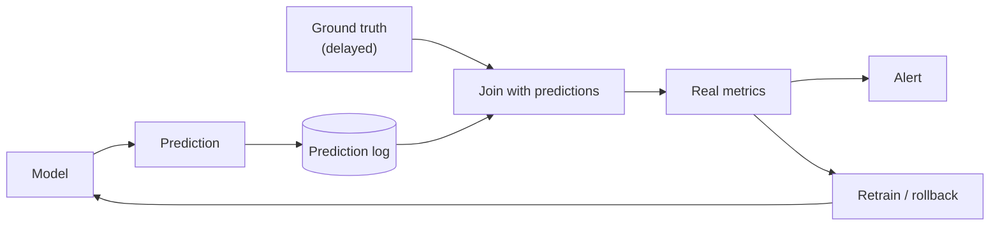

---
aliases:
  - Circuito fechado
---
#mlops #monitoring #production #model-quality

## What it is

The ground truth (labels, user actions, outcomes) **comes back** and is joined to the original predictions. This allows computing real performance and using the labeled results as new training data, closing the loop.

>[!tip] **Monitoring a deployed model ==🔴with ground truth== feedback.

**Example:** a recommender, where a click or no-click arrives within seconds.

## Steps

1. **Log** inputs and predictions with an ID and timestamp.
2. **Collect** the ground truth when it becomes available (see [[Ground Truth]]).
3. **Join** labels with the logged predictions.
4. **Compute** real metrics: [[Accuracy]], [[Precision]], [[Recall]], [[F1-Score]], [[ROC-AUC]], or error for regression.
5. **Compare** with the training baseline and alert on a drop.
6. **Retrain** with the new labeled data and validate with [[champion and challenger]].

## Pros and cons

| Pros | Cons |
| --- | --- |
| Direct measurement of real performance | Needs labels, which can be late or costly |
| Detects [[concept drift]] | Delay between prediction and evaluation |
| Feeds retraining data | Needs a reliable join between predictions and labels |

## Pitfalls

- **Label delay:** compare metrics only for cohorts whose labels are complete.
- **Selection bias:** you may only get labels for the cases the model approved.
- **Feedback loops:** the model's decisions influence the labels it later receives.

## When to use

- Labels arrive in a reasonable time.
- To **confirm** that drift flagged by [[Open loop monitoring]] is real degradation.
- To decide on retraining and promotion.

See also [[Model drift]] and [[Monitor Accuracy in Production Continuously]].
