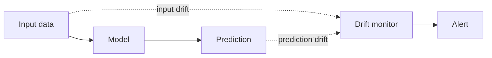

---
aliases:
  - Circuito aberto
---
#mlops #monitoring #production #model-quality
## What it is

The true outcome is not available, or it arrives too late, so real performance cannot be computed. Instead, you monitor **proxy signals** that indicate the model may be degrading.

>[!tip] Monitoring a deployed model **==🔴without== ground truth**.

**Example:** a credit default model, where the real outcome takes 12 months. You check whether today's applicants look like the training population.

## Signals

| Signal | What it checks | Tools |
| --- | --- | --- |
| **Input drift** | Feature distributions vs training (see [[data drift]]) | [[Population Stability Index (PSI)]], KS test |
| **Prediction drift** | Distribution of scores or predicted classes | PSI, histograms |
| **Data quality** | Nulls, schema, ranges, freshness | [[data quality]], [[AWS Deequ]] |
| **Model confidence** | Share of low-confidence predictions | Score thresholds |
| **Operational** | Latency, errors, throughput | Dashboards and alerts |

## Pros and cons

| Pros | Cons |
| --- | --- |
| Immediate, no need to wait for labels | Indirect: drift does not prove degradation |
| Cheap to implement | Can raise false alarms (drift without performance loss) |
| Works when labels never arrive | Cannot detect [[concept drift]] on its own |

## When to use

- Labels are delayed, expensive or unavailable.
- As an **early warning** before labels arrive.
- As the first monitoring layer of any new model.

## Next step

When labels arrive, confirm with [[Closed loop monitoring]]. See also [[Model drift]].
