# Steps to model monitoring

```mermaid
%%{init: {"flowchart": {"curve": "basis", "nodeSpacing": 30, "rankSpacing": 60}}}%%
flowchart LR

    %% ---------- Data platform ----------
    subgraph DATA["Data Platform"]
        DQ{{"Data quality checks<br/>schema, nulls, ranges"}}
        PSI{{"PSI validation"}}
        FS[("Offline Feature Store")]
        OFS[("Online Feature Store")]
        DQ --> PSI --> FS
        FS --> OFS
    end

    %% ---------- Training ----------
    subgraph TRAIN["Training & Release"]
        A["Train dataset"]
        B@{ shape: win-pane, label: "Baseline metrics" }
        MD["Model"]
        R["Retrain process"]
        SCH["Weekly scheduled retrain"]
        VAL{{"Validation gate<br/>champion / challenger<br/>recent labeled test set"}}
        REG[("Model Registry<br/>versions, rollback")]
        A --> B
        A --> MD
        SCH --> R
        R --> MD
        MD --> VAL
        VAL -->|approved| REG
    end

    %% ---------- Serving ----------
    subgraph SERVE["Serving"]
        subgraph EP["Endpoint + shadow probe"]
            C["Online Endpoint"]
            BM["Baseline model probe<br/>output not delivered"]
            C -->|"same inputs"| BM
        end
        D[("Collected data for auditing<br/>prediction id, timestamp, model version")]
        LOG[("Request / response<br/>logs & traces")]
        INF["Infra & service metrics<br/>latency, throughput, errors, cost"]
        C --> D
        BM -->|"predictions logged"| D
        C --> LOG
        C --> INF
    end

    %% ---------- Monitoring ----------
    subgraph MON["Monitoring"]
        direction TB

        subgraph OL["Open Loop - no ground truth"]
            PSI2{{"Input drift<br/>PSI, KS, chi-square, JS"}}
            DQ2{{"Production data quality"}}
            PD{{"Prediction distribution<br/>positive rate vs reference"}}
            CONF{{"Confidence scores<br/>mean confidence, uncertain share"}}
            SCORE{{"Score distribution<br/>KS test vs held-out reference"}}
            DIS{{"Disagreement rate<br/>main vs baseline model"}}
            SK{{"Training-serving skew"}}
        end

        subgraph CL["Closed Loop - with ground truth"]
            HL["Human labeling<br/>& user feedback loop"]
            GT[("Ground truth<br/>joined by prediction id")]
            CM{{"Classification metrics<br/>Accuracy, F1-score, Recall, Precision"}}
            RM{{"Regression metrics<br/>R-squared, MAE, RMSE"}}
            CD{{"Concept drift"}}
            FAIR{{"Fairness, bias & explainability<br/>SHAP drift"}}
            HL --> GT
            GT --> CM
            GT --> RM
            GT --> CD
            GT --> FAIR
        end

        M["Monitoring Job"]
    end

    %% ---------- Alerting ----------
    subgraph ALERT["Alerting & Reporting"]
        AL["Alerting & notification<br/>on-call, chat, email"]
        DASH["Dashboards"]
    end

    %% ---------- Cross-component flow ----------
    FS --> A
    FS -->|"latest features"| R
    OFS --> C
    REG -->|"canary / shadow / A-B"| C

    A -->|reference| OL
    D --> OL
    D --> CL
    OL --> M
    CL --> M
    B --> M

    M -->|"x > threshold y"| R
    M --> AL
    M --> DASH
    INF --> AL
    INF --> DASH
    LOG --> DASH

    %% ---------- Styling ----------
    classDef store fill:#e3f2fd,stroke:#1565c0,stroke-width:1.5px,color:#0d2f57
    classDef process fill:#f3e5f5,stroke:#7b1fa2,stroke-width:1.5px,color:#3a0f4d
    classDef check fill:#fff8e1,stroke:#f9a825,stroke-width:1.5px,color:#4a3600
    classDef metric fill:#e8f5e9,stroke:#2e7d32,stroke-width:1.5px,color:#0f3d14
    classDef alert fill:#ffebee,stroke:#c62828,stroke-width:1.5px,color:#5c0f0f

    class FS,OFS,REG,D,LOG,GT store
    class A,MD,R,SCH,C,HL,M,BM process
    class DQ,PSI,VAL,PSI2,DQ2,PD,CONF,SCORE,DIS,SK,CD,FAIR check
    class B,CM,RM,INF metric
    class AL,DASH alert

    style DATA fill:#f7f9fc,stroke:#90a4ae,color:#263238
    style TRAIN fill:#f7f9fc,stroke:#90a4ae,color:#263238
    style SERVE fill:#f7f9fc,stroke:#90a4ae,color:#263238
    style EP fill:#faf5fc,stroke:#7b1fa2,stroke-dasharray:5 3,color:#263238
    style MON fill:#fbfbf7,stroke:#90a4ae,color:#263238
    style OL fill:#fffdf3,stroke:#f9a825,stroke-dasharray:5 3,color:#263238
    style CL fill:#f4fbf5,stroke:#2e7d32,color:#263238
    style ALERT fill:#fff7f7,stroke:#c62828,color:#263238
```

**Legend**

| Color | Meaning |
|---|---|
| Blue | Data stores (feature stores, registry, logs, ground truth) |
| Purple | Processes and components (datasets, model, endpoint, jobs) |
| Yellow | Checks and validations (quality, drift, skew, gates) |
| Green | Metrics |
| Red | Alerting and reporting |

**Related:** [[Monitor Accuracy in Production Continuously]]
