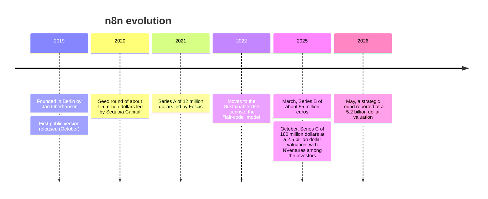
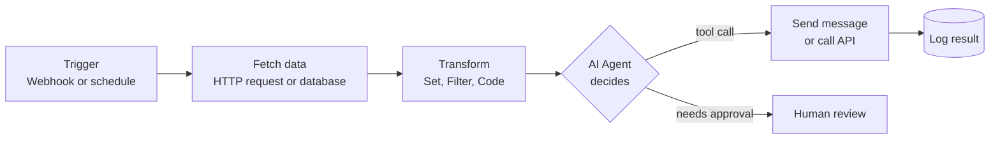

---
aliases:
  - n8n
  - N8N
  - n8n.io
tags:
  - automation
  - workflow
  - low-code
  - ai
  - agents
---


The dates and amounts come from press articles and funding trackers, and some sources disagree on rounds and valuations. The 2022 license change comes from memory and was not confirmed in the search. Check the official n8n blog and license file before citing them.

**n8n** (pronounced "n-eight-n", short for "nodemation") is a **workflow automation platform** with a visual, node-based editor. You connect triggers, apps, APIs, code and AI models as nodes on a canvas, and n8n runs the resulting workflow. It sits between no-code tools and plain scripts: most of the work is drag and drop, but you can drop into JavaScript or Python and call any HTTP API when a ready node is missing.

>[!tip] n8n is the **glue** between systems. It receives an event (a webhook, a schedule, a new email, a database change), transforms the data, calls other services and, more and more, lets an **AI agent** decide what to do.

## Fair-code license

n8n is **fair-code**: the source code is public and you can self-host it for free, but it is **not** OSI open source. The Sustainable Use License allows internal business use and free self-hosting, and restricts selling n8n itself or offering it as a hosted service to others without a commercial agreement.

| | n8n | Fully open source tool |
|---|---|---|
| Source code visible | Yes | Yes |
| Free to self-host for your own use | Yes | Yes |
| Resell as a hosted service | Needs a commercial license | Allowed |
| Official license type | Fair-code (Sustainable Use License) | OSI-approved |

## Core concepts

| Concept | Meaning |
|---|---|
| **Workflow** | A graph of connected nodes that runs from a trigger to the end |
| **Node** | One step: a trigger, an app action, a data transformation, code or an AI component |
| **Trigger node** | Starts the workflow: webhook, schedule (cron), app event, form, chat message |
| **Connection** | Passes the output items of one node to the input of the next |
| **Item** | The unit of data that flows between nodes. Each node runs once for every item |
| **Expression** | A small JavaScript snippet inside `{{ }}` that reads data from previous nodes |
| **Credentials** | Stored, encrypted access data for an app or API |
| **Execution** | One run of a workflow, with the input and output of each node saved for debugging |
| **Sub-workflow** | A workflow called from another one, for reuse |



## Common nodes

| Group | Examples |
|---|---|
| **Triggers** | Webhook, Schedule, Form, Chat, app triggers |
| **Flow control** | IF, Switch, Merge, Loop Over Items, Wait |
| **Data** | Set (Edit Fields), Filter, Aggregate, Split Out |
| **Code** | Code node (JavaScript, and Python), Execute Command |
| **Network** | HTTP Request, GraphQL, Respond to Webhook |
| **Apps** | Hundreds of integrations: Slack, Google Sheets, GitHub, Postgres, S3, email... |
| **AI** | AI Agent, Chat Model, Memory, Tools, Vector Stores, Embeddings (built on [[LangChain SDK]] concepts) |

The **HTTP Request** node is the escape hatch: any service with an API can be integrated even if n8n has no dedicated node.

## AI agents in n8n

n8n has a set of **AI nodes** that follow the same ideas as other [[AI Agent|agent]] frameworks:

- **AI Agent node:** the model reasons and chooses which tool to call.
- **Chat model sub-node:** the LLM (hosted or local).
- **Memory sub-node:** conversation history, see [[Agent Memory]].
- **Tool sub-nodes:** other nodes, workflows, HTTP calls or code exposed as tools.
- **Vector store and embeddings nodes:** the building blocks of [[RAG]] workflows.
- **MCP nodes:** an **MCP Server Trigger** exposes n8n workflows as tools for an external client, and an MCP client tool lets the agent use external servers. See [[MCP]].

Typical patterns:
- A chatbot with a knowledge base (RAG) that answers from documents.
- An agent that reads incoming emails, classifies them and calls the right tool.
- A workflow that uses the LLM only for one step (extract fields from text) and plain nodes for the rest.

>[!note] The SSE (Server-Sent Events) transport for MCP is deprecated in favor of streamable HTTP, so prefer the newer transport when you configure MCP connections. (This replaces the original one-line note in this file, "Server sent events deprecated". Confirm the meaning against your n8n version.)

>[!warning] An agent with write tools can do damage. Give it only the tools it needs, use read-only credentials where possible, and add a [[Human-in-the-Loop]] approval step before actions that send, delete or pay.

## Deployment

| Option | Notes |
|---|---|
| **n8n Cloud** | Hosted by n8n, billed by plan and number of executions, no servers to run |
| **Self-hosted (Docker)** | Free Community Edition, you run the container, the database and the backups |
| **Self-hosted on Kubernetes** | For scale, with several workers |

```bash
# Quick start with Docker (data is kept in a named volume)
docker volume create n8n_data
docker run -it --rm --name n8n -p 5678:5678 \
  -v n8n_data:/home/node/.n8n \
  docker.n8n.io/n8nio/n8n
```

Then open `http://localhost:5678`.

### Scaling: queue mode

By default one process runs everything. In **queue mode** the main instance receives triggers and puts executions in a **queue** (Redis), and separate **worker** processes execute them. A real database such as Postgres is used instead of the default SQLite. Queue mode needs the right plan or edition, and some features (for example the MCP Server Trigger with several replicas) need extra routing, so check the current documentation.

## Pricing model

The cloud plans are billed mainly by **workflow executions**, not by the number of steps, and some features such as SSO, Git integration and queue mode are reserved for higher plans. The Community Edition is free to self-host. Check the official pricing page for current numbers.

## n8n vs other tools

| Tool | Type | Main difference from n8n |
|---|---|---|
| **Zapier** | Closed SaaS | Easiest to start, very large app catalog, pay per task, cannot be self-hosted |
| **Make** | Closed SaaS | Visual scenarios, strong data mapping, billed per operation |
| **Activepieces** | Open source | MIT-style license and a similar visual model |
| **Node-RED** | Open source | Flow-based, strong in IoT and event wiring |
| [[LangFlow]] | Open source | Focused on building LLM flows and agents, less on general app integration |
| **Flowise / Dify** | Open source | LLM application builders with a chat and RAG focus |
| [[Apache Airflow]] | Open source | Code-first **data pipeline** orchestration, scheduled batch DAGs. See [[providers/Google/GCP Cloud Composer.md\|Cloud Composer]] |
| [[RPA - Robotic Process Automation\|RPA]] tools | Mostly commercial | Automate desktop and legacy UIs by imitating clicks, not APIs |

**How to choose:**
- Integrate SaaS apps and APIs with some AI, and keep data on your servers: **n8n**.
- Heavy batch data pipelines with dependencies, backfills and SLAs: **Airflow** or **Cloud Composer**, not n8n.
- Pure LLM or RAG application with a chat UI: **LangFlow**, Flowise or Dify, or code with a framework such as [[llm/platform & framework/Google ADK.md|Google ADK]].
- Legacy desktop applications with no API: **RPA**.

## n8n in data engineering

- **Alerts and notifications:** a failed pipeline posts to chat, with the error and a link.
- **Light ingestion:** pull from a SaaS API and write to a database or a bucket, for small volumes.
- **Triggering pipelines:** call the Airflow or Dataform API when a file arrives.
- **Self-service:** a form or chat that runs a parameterized job.
- **Data quality triage:** an agent reads failed checks and opens a ticket.

It is not a replacement for a data orchestrator: it has no native model for data intervals, backfills or lineage.

## Best practices

- Name every node with its purpose, and keep workflows small. Use **sub-workflows** for reuse.
- Add an **Error Trigger** workflow that alerts you when any workflow fails.
- Use **credentials**, never put secrets in node fields or expressions.
- Make workflows **idempotent**, because retries and webhook re-deliveries happen.
- Process large data in batches (Loop Over Items) and avoid loading everything in memory.
- Version workflows (export the JSON to Git, or use the Git integration if your plan has it).
- Separate dev and prod instances, and protect webhooks with authentication.
- Log the input and output of AI steps, and test prompts with real examples.

## Common pitfalls

- Using n8n for heavy data processing, which fills the memory of the process.
- Forgetting that each node runs **once per item**, which multiplies API calls and cost.
- Public webhooks with no authentication.
- Giving an AI agent write tools without an approval step.
- Self-hosting with the default SQLite and no backups in production.
- Building one huge workflow instead of several linked ones, which is hard to debug.
- Assuming that a Community Edition feature exists, when it belongs to a paid plan.

## Related

- [[LangFlow]]
- [[Apache Airflow]]
- [[MCP]]
- [[A2A]]
- [[Multi-agent orchestration]]

## Interview questions

- What is n8n, and what does "fair-code" mean?
- How is n8n different from Zapier and from Airflow?
- What are items, and why does a node run once per item?
- How does the AI Agent node decide what to do, and how do you restrict it?
- How would you scale n8n, and what changes in queue mode?
- When should you not use n8n?
- How do you handle errors, retries and idempotency in a workflow?
- How would you secure a public webhook?
