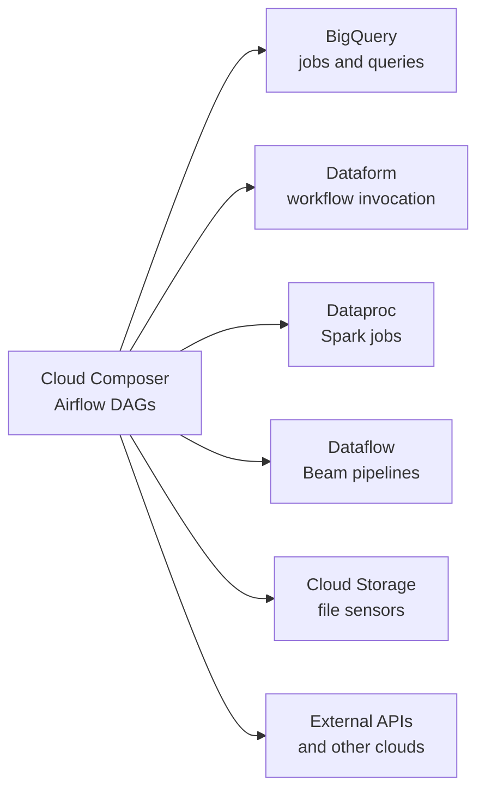

---
aliases:
  - Cloud Composer
  - Composer
  - GCP Composer
tags:
  - gcp
  - orchestration
  - data-engineering
  - airflow
---
**Cloud Composer** is Google Cloud's **fully managed [[Apache Airflow]] service**. You write normal Airflow DAGs in Python, and Google runs and operates the scheduler, workers, web server and metadata database for you. It is the same Airflow API as the open source project, wrapped with Google Cloud networking, security, logging and monitoring.

>[!tip] Composer = Airflow + managed infrastructure on Google Cloud. If you know Airflow, you know how to write for Composer. What changes is how you **deploy, size, secure and pay** for it.

## What it orchestrates

Composer does not process data itself. It **triggers and monitors** other systems and waits for them, in the right order, with retries and alerts.



Typical use: ingest files, run a transformation ([[data architecture/Data Warehouse/Google Dataform.md|Dataform]] or SQL in BigQuery), run data quality checks, then notify or trigger a model training job.

## Architecture

A Composer **environment** is one Airflow deployment. Its main parts:

| Component | Role |
|---|---|
| **Scheduler** | Reads the DAGs and decides which tasks to run and when |
| **Workers** | Execute the tasks. They autoscale between a minimum and a maximum |
| **Triggerer** | Runs deferrable operators, which wait for events without holding a worker slot |
| **DAG processor** | Parses the DAG files (a separate component in recent versions) |
| **Web server** | The Airflow UI, protected by Google Cloud IAM |
| **Metadata database** | Stores DAG runs, task state, connections and variables (managed Cloud SQL) |
| **Cloud Storage bucket** | Holds `dags/`, `plugins/`, `data/` and logs. Deploying a DAG means copying a file here |

In older versions (Composer 1 and 2) the environment ran on a GKE cluster in your project. Composer 3 hides more of this infrastructure, so there is less to operate. Check the official docs for the exact architecture of the version you use.

### Deploying a DAG

```bash
# Copy a DAG file to the environment bucket
gcloud composer environments storage dags import \
  --environment my-env --location us-central1 \
  --source my_dag.py
```

In practice a **CI/CD pipeline** syncs the `dags/` folder of a Git repository to the bucket after tests pass, instead of copying files by hand.

## A DAG using Google operators

```python
from datetime import datetime

from airflow import DAG
from airflow.providers.google.cloud.operators.bigquery import (
    BigQueryInsertJobOperator,
)

with DAG(
    dag_id="daily_revenue",
    schedule="0 3 * * *",
    start_date=datetime(2026, 1, 1),
    catchup=False,
    default_args={"retries": 2},
) as dag:
    build = BigQueryInsertJobOperator(
        task_id="build_daily_revenue",
        configuration={
            "query": {
                "query": "SELECT customer_id, SUM(amount) AS revenue "
                         "FROM sales.orders GROUP BY 1",
                "useLegacySql": False,
                "destinationTable": {
                    "projectId": "my-project",
                    "datasetId": "analytics",
                    "tableId": "daily_revenue",
                },
                "writeDisposition": "WRITE_TRUNCATE",
            }
        },
    )
```

The Google operators come from the `apache-airflow-providers-google` package, which is installed in Composer. It has operators for BigQuery, Dataproc, Dataflow, Cloud Storage, Pub/Sub, Dataform, Vertex AI and more.

>[!warning] Keep heavy work **out** of the Composer workers. Use the DAG to start a BigQuery, Dataproc or Dataflow job and wait for it. Running big pandas jobs inside a worker is a common cause of slow and unstable environments.

## Features

| Area | What Composer gives you |
|---|---|
| **Scaling** | Workers autoscale, and the environment has size presets |
| **Security** | IAM access control, private IP, customer-managed encryption keys, VPC Service Controls |
| **Secrets** | Airflow connections and variables can be stored in Secret Manager |
| **Observability** | Logs in Cloud Logging, metrics in Cloud Monitoring, alerts |
| **Upgrades** | Image versions that pair an Airflow version with a Composer build, with in-place upgrades and snapshots |
| **Infrastructure as code** | The environment is a Google Cloud resource, managed with Terraform (`google_composer_environment`) |

## Versions

Composer environments are created from an **image version**, named after the Composer major version and the Airflow version, for example `composer-3-airflow-x.y.z-build.n`. Composer 3 is the current generation, and it offers Airflow 2 and, as reported by Google's versioning page, Airflow 3 (check whether it is still in preview). Older Composer generations are being retired, so check the support dates before creating a new environment on one.

Composer 3 pricing is described by secondary sources as based on compute units that combine CPU and memory. Check Google's pricing page for the current model.

## Cost model

The main thing to remember: a Composer environment is **always on**. You pay for the scheduler, the database and the minimum workers even when no DAG is running, plus storage and network.

- Share one environment between teams when isolation allows it, instead of one per DAG.
- Set a low minimum number of workers and let autoscaling handle peaks.
- Use deferrable operators and sensors in `reschedule` mode to avoid idle worker slots.
- For a handful of simple jobs, a cheaper tool may be enough (see below).

## Open source and equivalent tools

Composer is one way to run Airflow. The others are self-hosting the open source project, other managed services, or different orchestrators.

| Option | Type | Notes |
|---|---|---|
| [[Apache Airflow]] | **Open source engine** | What Composer runs. Self-hosted on Kubernetes (official Helm chart) or on VMs, with full control and full operation cost |
| **Amazon MWAA** | Managed Airflow on AWS | Direct equivalent of Composer on AWS. |
| **Astronomer (Astro)** | Managed Airflow, multi-cloud | Vendor focused on Airflow, runs on several clouds |
| **Azure Data Factory** (managed Airflow) | Managed Airflow on Azure | Airflow inside the Azure data service |
| **Dagster** | Open source orchestrator | Asset-based model: you declare the data assets and their dependencies, not only tasks |
| **Prefect** | Open source orchestrator | Python-first, flows are plain functions, lighter to start |
| **Argo Workflows** | Open source, Kubernetes-native | Each step is a container. Good if everything already runs on Kubernetes |
| **Kestra** | Open source orchestrator | YAML-defined workflows with a UI and many plugins |
| **Cloud Workflows + Cloud Scheduler** | Google Cloud serverless | Pay per execution, no environment to keep. Good for simple API and service chains |
| **Dataform workflow configurations** | Google Cloud, built in | Scheduling for SQL transformations in BigQuery with no extra orchestrator. See [[data architecture/Data Warehouse/Google Dataform.md\|Google Dataform]] |

### How to choose

| Situation | Pick |
|---|---|
| Already on Google Cloud, many data pipelines across BigQuery, Dataproc and Dataflow | **Cloud Composer** |
| Only SQL transformations in BigQuery | Dataform schedules, no Composer needed |
| A few API calls and service steps, low volume | Cloud Workflows with Cloud Scheduler |
| Same Airflow code must run on any cloud or on-premises | Self-hosted Airflow on Kubernetes, or a multi-cloud vendor |
| The team thinks in data assets and lineage | Dagster |
| Everything is containers on Kubernetes | Argo Workflows |

Because Composer runs standard Airflow, **moving between Composer, MWAA, Astronomer and self-hosted Airflow mostly means moving the DAG files and re-creating connections and infrastructure**. Provider-specific operators (Google operators) are the part that ties a DAG to a cloud.

## Best practices

- Keep DAG files light: no heavy imports or queries at the top level, because the scheduler parses them continuously.
- Make tasks **idempotent**, so a retry or a [[backfill]] does not duplicate data.
- Use `catchup=False` unless you really need to run past intervals.
- Delegate the work to BigQuery, Dataproc, Dataflow or Dataform, and keep Composer as the coordinator.
- Store secrets in Secret Manager, not in DAG code or plain variables.
- Give each environment a dedicated **service account** with least privilege.
- Test DAGs in CI (import check and unit tests) before syncing to the bucket.
- Version and review the environment with Terraform.
- Set retries, timeouts and alerts on failure for every important DAG.

## Common pitfalls

- Paying for an idle environment that runs only a few jobs.
- Heavy processing inside Airflow workers instead of in the data services.
- DAGs that make network or database calls while being parsed, which slows the scheduler.
- Too many tiny tasks, which overloads the scheduler and the metadata database.
- Using the Airflow metadata database as a data store for results.
- Hard-coded project IDs and datasets, which break the move between dev and prod.
- Upgrading the image version in production without testing the DAGs first.

## Related

- [[Airflow Operators Chain]]
- [[Orchestration]]
- [[backfill]]
- [[data architecture/Data Warehouse/Google Dataform.md|Google Dataform]]

## Interview questions

- What does Cloud Composer manage for you that open source Airflow does not?
- Where do DAG files live, and how do you deploy them safely?
- Why should heavy processing stay out of Composer workers?
- How do deferrable operators reduce cost?
- How would you choose between Composer, Dataform schedules and Cloud Workflows?
- What changes if you migrate from Composer to MWAA or to self-hosted Airflow?
- How do you make a DAG idempotent so a backfill is safe?
- How would you manage a Composer environment with Terraform and CI/CD?
