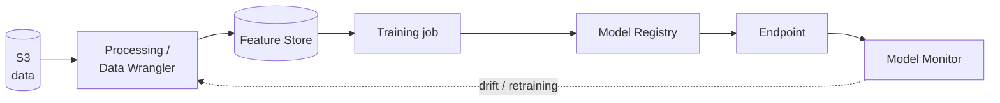

#aws #mlops #machine-learning #provider

A fully managed AWS service to **build, train, deploy and monitor** machine learning models. Now branded **Amazon SageMaker AI**, it covers the whole [[ML Lifecycle]] in one platform.

## Main capabilities

| Stage | Capability | Purpose |
| --- | --- | --- |
| Data | **Data Wrangler**, **Processing jobs**, **Ground Truth** | Prepare, transform and label data |
| Features | **Feature Store** | Online and offline feature storage (see [[Online Feature Store]] and [[Offline Feature Store]]) |
| Develop | **Studio** (notebooks / IDE) | Interactive development environment |
| Train | **Training jobs**, **Automatic Model Tuning**, **HyperPod** | Managed, distributed training and hyperparameter search |
| Track | **Experiments** | Compare runs, parameters and metrics |
| Orchestrate | **Pipelines** | Automate the workflow as a DAG (CI/CD for ML) |
| Version | **Model Registry** | Versioning and approval of models |
| Deploy | **Endpoints** | Real-time, serverless, asynchronous and batch inference |
| Monitor | **Model Monitor**, **Clarify** | Data and model drift, bias and explainability |
| Foundation models | **JumpStart** | Pre-trained models and solution templates |

## Inference options

| Option | When to use |
| --- | --- |
| **Real-time endpoint** | Low latency, steady traffic |
| **Serverless inference** | Intermittent traffic, scale to zero |
| **Asynchronous inference** | Large payloads or long processing time |
| **Batch transform** | Score a full dataset offline |

## Lifecycle on SageMaker



## Example (Python SDK)

```bash
pip install sagemaker boto3
```

```python
import sagemaker
from sagemaker.sklearn.estimator import SKLearn

session = sagemaker.Session()
role = "arn:aws:iam::<account-id>:role/<sagemaker-execution-role>"

estimator = SKLearn(
    entry_point="train.py",
    framework_version="1.2-1",
    instance_type="ml.m5.large",
    instance_count=1,
    role=role,
    sagemaker_session=session,
)

estimator.fit({"train": "s3://my-bucket/train/"})

predictor = estimator.deploy(
    initial_instance_count=1,
    instance_type="ml.m5.large",
)

print(predictor.predict([[0.1, 0.2, 0.3]]))
predictor.delete_endpoint()   # avoid paying for an idle endpoint
```

The SDK API changes between major versions, so check the installed `sagemaker` version before running.

## Who uses what ([[ML Lifecycle]])

- **Data Engineer:** Processing jobs, Feature Store ingestion, data in [[AWS S3]].
- **Data Scientist:** Studio, Training jobs, Experiments, Automatic Model Tuning.
- **Machine Learning Engineer:** Pipelines, Model Registry, Endpoints, Model Monitor.
- **Software Engineer:** integrates the endpoint into applications.

## Pros and cons

| Pros | Cons |
| --- | --- |
| End-to-end managed MLOps | Vendor lock-in |
| Scales training and inference | Costs add up, especially idle endpoints and notebooks |
| Integrates with S3, IAM, CloudWatch | Many services and a learning curve |

## Cost tips

- Delete unused endpoints and stop idle Studio apps.
- Use serverless or asynchronous inference for sporadic traffic.
- Use managed Spot training for fault-tolerant training jobs.

## Related

[[AWS cloud]], [[AWS CloudWatch 1|AWS CloudWatch]], [[AWS Deequ]], [[AWS Athena]]
