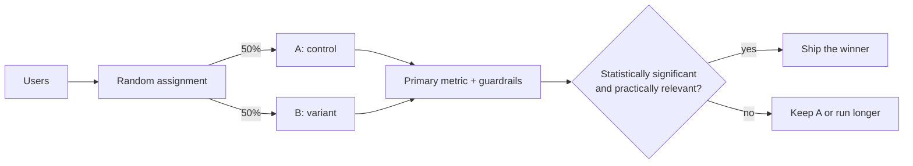

---
aliases:
  - A/B test
  - A/B testing
  - A/B
  - split test
---
#deployment #experimentation #statistics

**A/B testing** is a controlled experiment that splits users randomly between two (or more) versions, **A** (control, usually the current version) and **B** (variant), and measures which one performs better on a predefined metric. It answers a business question: *"Is B better than A?"*

It is not a release-safety mechanism. For "is this version safe to release?", see [[canary deployment]].



## How it works

1. **Hypothesis:** e.g. "The new checkout page raises conversion by at least 1 percentage point"
2. **Choose the metrics:** one *primary* metric, plus *guardrail* metrics that must not get worse (latency, error rate, revenue, complaints)
3. **Choose the randomization unit:** user, session or request. Users are the usual choice, so each person always sees the same variant
4. **Size the experiment** before starting (see below)
5. **Run for the planned duration** without stopping early on a good-looking result
6. **Check validity, then analyze** with a statistical test
7. **Decide:** ship B, keep A, or iterate

## Sample size

Decide before the test how many users you need. It depends on:

- the **baseline rate** (e.g. 10% conversion)
- the **minimum detectable effect** (MDE): the smallest change worth detecting (e.g. +1 point)
- the **significance level** α (usually 0.05) and the **power** 1 − β (usually 0.8)

Smaller effects and noisier metrics need many more users. Example: baseline 10%, MDE +1 point (10% → 11%), α = 0.05, power 0.8 needs about **14,700 users per group**. A common rule of thumb for proportions is $n \approx 16\,p(1-p)/\delta^2$ per group (about 14,400 here).

## Analyzing the result

Example with a two-proportion z-test:

```python
import numpy as np
from scipy.stats import norm

def two_proportion_ztest(x_a, n_a, x_b, n_b):
    p_a, p_b = x_a / n_a, x_b / n_b
    p = (x_a + x_b) / (n_a + n_b)  # pooled rate
    se = np.sqrt(p * (1 - p) * (1 / n_a + 1 / n_b))
    z = (p_b - p_a) / se
    return z, 2 * (1 - norm.cdf(abs(z)))  # two-sided p-value

# A: 1000 conversions out of 10000 (10.0%); B: 1100 out of 10000 (11.0%)
z, p_value = two_proportion_ztest(1000, 10000, 1100, 10000)
print(f"z = {z:.2f}, p-value = {p_value:.3f}")  # z = 2.31, p-value = 0.021
```

The p-value of 0.021 is below 0.05, so the difference is statistically significant. Also report the **effect size with a confidence interval**, and ask whether the gain is **practically relevant**, not only significant. For continuous metrics (revenue per user) use a t-test or a bootstrap.

## Pitfalls

- **Peeking:** checking the result every day and stopping when p < 0.05 inflates false positives. Fix the duration up front, or use a sequential testing method designed for continuous monitoring
- **Sample ratio mismatch (SRM):** if you planned 50/50 and observed 52/48 with a large sample, the assignment or logging is broken and the result is not trustworthy. Check it first
- **Multiple comparisons:** many variants or many metrics raise the chance that something looks significant by luck. Correct for it (e.g. Bonferroni) or pre-register the primary metric
- **Too short a duration:** run at least one full business cycle (usually whole weeks) to cover weekday and weekend behavior
- **Novelty and primacy effects:** users may click a new design out of curiosity, or resist change at first. Early results may not last
- **Interference between users:** in marketplaces and social networks, one user's variant affects others, which violates the independence assumption
- **Changing things mid-test:** bug fixes, traffic changes or a second experiment on the same users can contaminate the result
- **Statistical significance ≠ business value:** a tiny gain can be significant with enough users and still not be worth shipping

## A/B test vs canary

| | A/B test | Canary |
|---|---|---|
| **Question** | Which version is better for the business? | Is this version safe to release? |
| **Decided by** | A hypothesis test on a predefined metric | Health metrics against rollback criteria |
| **Traffic split** | Fixed (e.g. 50/50), random, held for the whole test | Small and growing in steps |
| **Duration** | Planned from the sample size | As long as needed to trust the health signals |
| **Outcome** | Winner may be A or B | Ends with 100% on the new version, or a rollback |
| **Needs a statistical test** | Yes | Usually not, but comparison helps |

The two are often combined: a canary first confirms the new version is safe, then an A/B test measures whether it is better.

## In machine learning

A/B testing is how you measure the **real impact** of a model: offline metrics like [[Precision]] or [[ROC-AUC]] do not guarantee better business results. A typical sequence for a new model is offline evaluation, shadow mode, then a canary or A/B split on live traffic before full promotion. See [[champion and challenger]].

Because the model's decisions can change user behavior and future labels, the experiment's business metric (e.g. conversion) is often more trustworthy than a metric computed from labels the model itself influenced.

## Related

- [[canary deployment]]
- [[deployment strategies]]
- [[champion and challenger]]
- [[Model drift]]
