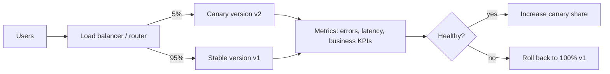

#deployment #devops #release-strategy

**Canary deployment** releases a new version to a **small share of real traffic** first, watches how it behaves, and only then widens the rollout. If the new version misbehaves, the traffic goes back to the old one and only a few users were affected.

The name comes from the canary in a coal mine: a small, early warning of danger.



## How it works

1. Deploy the new version **next to** the stable one (both are running)
2. Route a small share of traffic to it (e.g. 1% to 5%)
3. Compare the canary with the stable version on the same metrics
4. If healthy, increase the share in steps (e.g. 5% → 25% → 50% → 100%)
5. If unhealthy, route 100% back to the stable version and investigate
6. When the canary reaches 100%, retire the old version (keep it available for a while for rollback)

## Choosing who sees the canary

| Strategy | How | Use when |
|---|---|---|
| **Random percentage** | A share of requests, picked at random | Stateless services, simplest option |
| **Sticky by user** | A user is consistently assigned to the same version (hash of user id or cookie) | Users should not flip between versions mid-session |
| **Cohort** | Internal staff first, then a region, tenant or beta group | You want a controlled audience or a low-risk first group |

## What to watch

Compare the canary against the stable version over the same period, not against an old baseline.

- **Technical:** error rate, latency (p95/p99), saturation (CPU, memory), restarts
- **Business:** conversion, checkout success, revenue per request, support tickets
- **Dependencies:** database load, downstream error rates, queue depth

Define the **rollback criteria before** the release (e.g. "error rate more than 1 point above stable for 5 minutes"), so the decision is not made under pressure.

## Automating it

A rollout can be controlled by a tool that shifts traffic in steps, queries the metrics, and rolls back automatically on failure (progressive delivery). Example with Argo Rollouts on Kubernetes:

```yaml
apiVersion: argoproj.io/v1alpha1
kind: Rollout
spec:
  strategy:
    canary:
      steps:
        - setWeight: 5
        - pause: {duration: 10m}
        - setWeight: 25
        - pause: {duration: 10m}
        - setWeight: 50
        - pause: {duration: 10m}
```

Common building blocks: weighted routing in a service mesh or ingress (Istio, Envoy, NGINX), weighted target groups on a cloud load balancer, feature flags, and controllers such as Argo Rollouts or Flagger.

## Requirements

- **Observability:** without good metrics, a canary only delays the failure
- **Backward compatibility:** the old and the new version run at the same time, so database schemas, APIs and message formats must work with both (expand then contract migrations)
- **Enough traffic:** with very little traffic, 5% may be too few requests to detect a problem
- **Fast, safe rollback:** the whole point is to be able to undo it
- **Session handling:** decide whether a user may see both versions

## Pitfalls

- **Unrepresentative canary traffic:** if the canary only gets internal users or one region, it may miss problems that appear elsewhere
- **Too short an observation window:** some failures only show up after a cache warms up, at a daily peak, or after a batch job
- **Noisy metrics:** a small canary share gives noisy numbers; use enough requests or a statistical comparison, not a single spike
- **Shared state:** if both versions write to the same database or cache, a bug in the canary can corrupt data that rollback does not undo
- **Stateful or one-way changes:** irreversible migrations make rollback impossible, so canary offers less protection

## Canary vs other strategies

| Strategy | Idea | Rollback | Extra cost | Risk exposure |
|---|---|---|---|---|
| **Canary** | Gradually shift a small share of traffic to the new version | Route traffic back | Low to medium | Small, grows with each step |
| **Blue-green** | Run a full second environment and switch all traffic at once | Switch back instantly | High (duplicate environment) | All users at the moment of the switch |
| **Rolling** | Replace instances one by one | Roll forward or redo the rollout | Low | Grows as instances are replaced; no clean comparison group |
| **[[A-B testing\|A/B test]]** | Split traffic to compare versions on a business hypothesis | Stop the experiment | Medium | Planned exposure to variants |
| **[[shadow deployment\|Shadow]]** | Copy live traffic to the new version, discard its responses | Nothing to roll back | Medium to high (double processing) | None for users |

Canary and A/B testing look similar but differ in intent: canary asks "is this version safe to release?", A/B asks "which version is better for the business?".

## In machine learning

The same idea applies to model releases: after a challenger passes offline evaluation and shadow mode, a canary answers a small share of live requests to measure real impact before full promotion. See [[champion and challenger]].

## Related

- [[A-B testing]]
- [[deployment strategies]]
- [[champion and challenger]]
- [[Model drift]]
