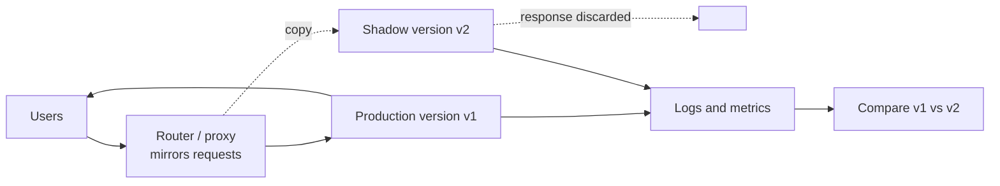

---
aliases:
  - shadow mode
  - shadow testing
  - traffic mirroring
  - dark launch
---
#deployment #devops #release-strategy

**Shadow deployment** runs a new version next to the production version and sends it a **copy of the live traffic**, but its responses are **discarded**: users only ever see the answer from the current version. It validates how the new version behaves on real inputs with **zero user impact**.



## How it works

1. Deploy the new version next to the production one
2. Configure the router or proxy to **mirror** (copy) requests to the shadow version
3. Return only the production response to the user, and ignore the shadow response
4. Collect logs and metrics from both and **compare them** offline
5. Once the shadow looks healthy, move to the next stage ([[canary deployment]] or full release)

The mirroring should be **asynchronous** ("fire and forget"), so a slow or failing shadow never delays or breaks the user's request.

## What to compare

- **Operational:** latency (p95/p99), error rate, CPU and memory, timeouts, crashes on real inputs
- **Functional:** differences between the production and shadow responses for the same request (a diff of outputs), and how often they disagree
- **Quality:** when ground truth arrives later (labels), the shadow's accuracy against the production version's

A disagreement is not automatically a bug: investigate the cases and decide which answer was right.

## Side effects

The shadow receives real requests, so it must **not cause real effects**:

- Writes to the production database, payments, emails, notifications and calls to third-party APIs must be disabled, stubbed or redirected to a sandbox
- Use a separate datastore (or a copy) for the shadow, so it cannot corrupt production data
- Make sure operations are idempotent where a duplicate cannot be avoided
- Respect privacy: mirrored requests carry real user data, so apply the same access control, retention and masking rules as production

This is the hardest part of shadowing a service that has state or side effects. Read-only, stateless, or pure-function services (e.g. model inference) are the easy case.

## Example: traffic mirroring with Istio

```yaml
apiVersion: networking.istio.io/v1
kind: VirtualService
metadata:
  name: app
spec:
  hosts:
    - app
  http:
    - route:
        - destination:
            host: app
            subset: v1
      mirror:
        host: app
        subset: v2
      mirrorPercentage:
        value: 100.0
```

Production traffic goes to `v1`, and a copy of each request goes to `v2`. Mirrored responses are dropped. NGINX (`mirror` directive) and Envoy also support request mirroring.

## Pros and cons

| Pros | Cons |
|---|---|
| No impact on users | Double the processing cost while it runs |
| Tests with real, current traffic instead of synthetic data | Cannot show real user impact, because the output is never used |
| Catches pipeline bugs, latency and memory problems early | Side effects need careful isolation |
| Good for comparing two implementations on identical inputs | Responses are not comparable if the shadow has different state or data |
| Safe place to test risky rewrites and migrations | Extra tooling and storage for the comparison |

## Shadow vs other strategies

| Strategy | Users see the new version? | Rollback | Typical question |
|---|---|---|---|
| **Shadow** | No | Nothing to roll back | Does it behave well on real inputs? |
| **[[canary deployment]]** | A small share | Route traffic back | Is it safe to release? |
| **[[A-B testing]]** | A planned share | Stop the experiment | Is it better for the business? |
| **Blue-green** | All, after the switch | Switch back | Can I release with instant rollback? |

Shadow is usually an **early stage**, before a canary or an A/B test. It cannot replace them, because it never measures how users react.

## In machine learning

Shadow mode is a standard step for model releases: a challenger model receives live requests and produces predictions that are stored but not returned. You can then compare it with the champion on latency, on agreement, and on accuracy once labels arrive, without exposing users. See [[champion and challenger]].

It is also the mechanism behind the baseline-model drift signal in [[Monitor Accuracy in Production Continuously]], with a different purpose: there, the second model is a permanent monitoring probe and is never promoted. A shadow challenger is a candidate for promotion.

A shadow model cannot show its real business impact, and if the model's decisions influence future labels, it cannot show that effect either.

## Related

- [[deployment strategies]]
- [[canary deployment]]
- [[A-B testing]]
- [[champion and challenger]]
- [[Monitor Accuracy in Production Continuously]]
